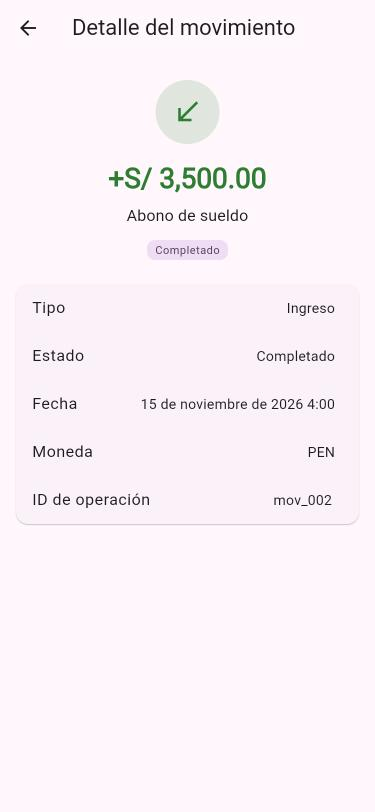
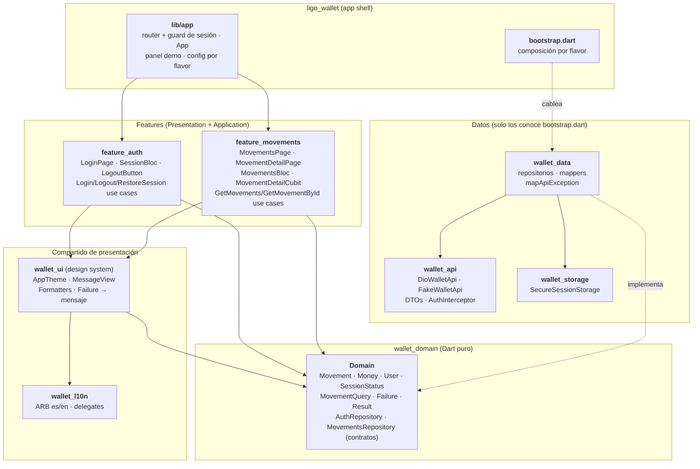
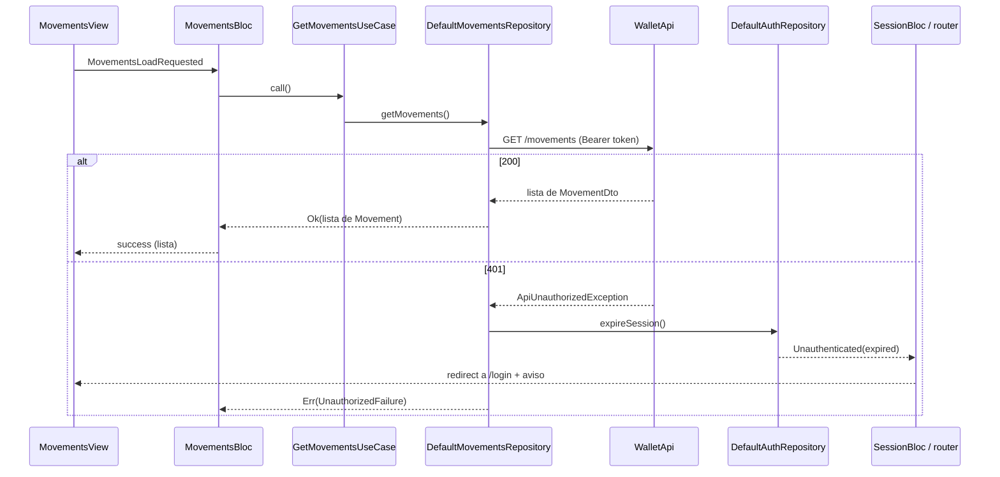
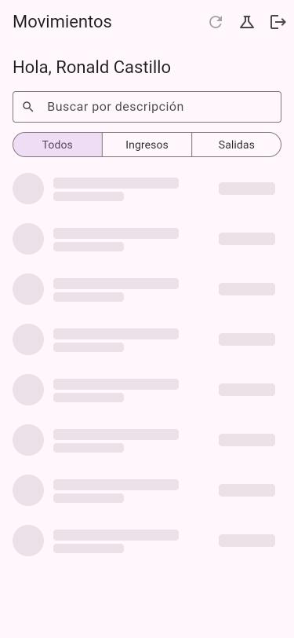
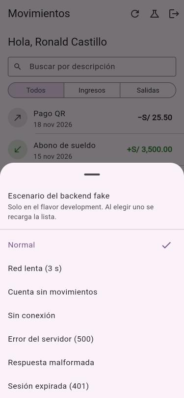
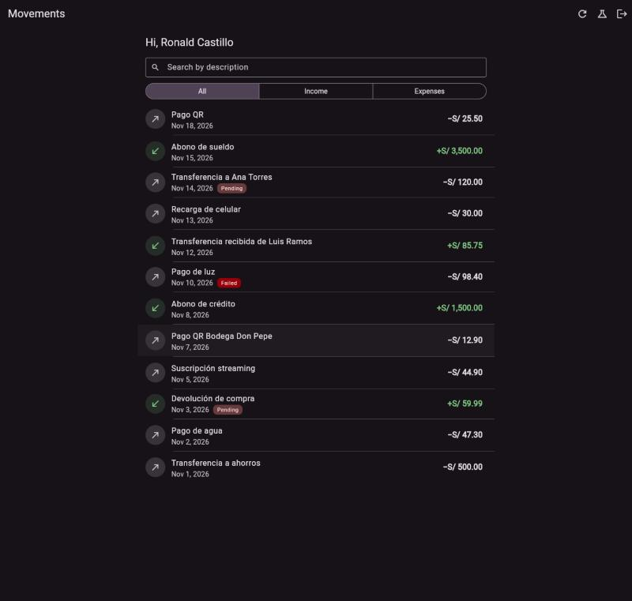

# Ligo Wallet — Movimientos de Cuenta

[](https://github.com/marlonpya/ligo-wallet/actions/workflows/main.yaml)
[](https://pub.dev/packages/very_good_analysis)
[](LICENSE)

Módulo de **Movimientos de Cuenta** de una billetera digital, construido para el *Flutter Senior Technical Challenge* de Ligo. Corre en **Android, iOS y Web** desde un mismo código, con Clean Architecture por capas, Bloc (MVI), sesión con JWT en almacenamiento seguro y un backend fake que permite demostrar cada estado de la UI.

| Login | Listado | Búsqueda + filtro | Detalle |
|:---:|:---:|:---:|:---:|
|  |  |  |  |

---

## Índice

1. [Funcionalidad](#funcionalidad)
2. [Cómo ejecutar](#cómo-ejecutar)
3. [Arquitectura](#arquitectura)
4. [Decisiones técnicas](#decisiones-técnicas)
5. [Manejo de estado y errores](#manejo-de-estado-y-errores)
6. [Testing](#testing)
7. [Seguridad](#seguridad)
8. [Supuestos sobre el contrato](#supuestos-sobre-el-contrato)
9. [Capturas](#capturas)
10. [Uso de IA](#uso-de-ia)
11. [Limitaciones y próximos pasos](#limitaciones-y-próximos-pasos)

---

## Funcionalidad

| Requisito del reto | Implementación |
|---|---|
| Login simulado con JWT | `FakeWalletApi` emite `mock-jwt-token` (el del contrato) y **valida el token** en cada petición como lo haría un backend real |
| Listado de movimientos | Más recientes primero; monto con signo, color e ícono; etiqueta de estado (pendiente, fallido) |
| Detalle de movimiento | Ruta `/movements/:id`; la URL se puede recargar o compartir en web |
| Loading / skeleton | Skeleton con la forma de las filas (sin dependencias externas) |
| Empty state | Dos estados distintos: **cuenta sin movimientos** y **sin resultados** para la búsqueda/filtro (con "Limpiar filtros") |
| Error state con Retry | Mensaje genérico localizado + "Reintentar". Si falla un refresco con datos visibles, se avisa con un snackbar sin ocultar la lista |
| Búsqueda por descripción | Debounce de 300 ms; ignora mayúsculas, tildes y espacios repetidos |
| Filtros Todos / Ingresos / Salidas | `SegmentedButton` de Material 3; se combina con la búsqueda |
| Pull to refresh | También con mouse/trackpad en web (`AppScrollBehavior`) y con un botón en la barra |
| Gestión de sesión y logout | Sesión restaurada al reabrir, logout con confirmación, **401 → cierre de sesión automático** con aviso |

Extras: i18n español/inglés (español por defecto), tema claro/oscuro, layout adaptado a web/tablet, y en el flavor `development` un **panel de escenarios** para forzar red lenta, cuenta vacía, errores o sesión expirada durante la demo.

---

## Cómo ejecutar

### Requisitos

- **Flutter ≥ 3.50** (Dart ≥ 3.14). El proyecto usa la sintaxis de constructores de Dart 3.14 que exige `very_good_analysis` 11; con versiones anteriores no compila.
- Opcional: [Very Good CLI](https://cli.vgv.dev) para correr los tests de todo el workspace con un comando.

```sh
git clone https://github.com/marlonpya/ligo-wallet.git
cd ligo-wallet
flutter pub get   # resuelve la app y los 8 paquetes (pub workspace) y genera l10n
```

### Flavors

| Flavor | Backend | Para qué |
|---|---|---|
| `development` | `FakeWalletApi` (en memoria, con latencia y fallos configurables) | Demo y desarrollo. **Es el que se debe usar para evaluar.** |
| `staging` | `DioWalletApi` → `API_BASE_URL` | Backend real de pruebas |
| `production` | `DioWalletApi` → `API_BASE_URL` | Backend real |

**Cuenta demo** (solo `development`): `demo@ligo.pe` / `ligo1234`. Cualquier otra combinación devuelve "Correo o contraseña incorrectos".

```sh
# Android / iOS
flutter run --flavor development --target lib/main_development.dart

# Web (Flutter web no soporta --flavor; el target elige el entorno)
flutter run -d chrome --target lib/main_development.dart
```

`staging` y `production` necesitan la URL del backend por `--dart-define`; la app exige HTTPS y falla al arrancar si falta:

```sh
flutter run --flavor production --target lib/main_production.dart \
  --dart-define=API_BASE_URL=https://api.ejemplo.com
```

> No hay un backend real detrás del contrato del reto: `staging`/`production` compilan y están cubiertos por tests contra un servidor HTTP simulado, pero solo `development` es navegable de punta a punta.

### Build de release (Android)

El release **exige un keystore propio** (no se firma con la clave de debug). Se pasa por variables de entorno, nunca en el repo:

```sh
export ANDROID_KEYSTORE_PATH=/ruta/upload.jks
export ANDROID_KEYSTORE_ALIAS=upload
export ANDROID_KEYSTORE_PASSWORD=...
export ANDROID_KEYSTORE_PRIVATE_KEY_PASSWORD=...

flutter build appbundle --flavor production --target lib/main_production.dart \
  --dart-define=API_BASE_URL=https://api.ejemplo.com \
  --obfuscate --split-debug-info=build/symbols
```

R8 (minificación) está activo en release; los símbolos de `--split-debug-info` se guardan fuera del artefacto para desofuscar crashes.

### Panel de escenarios (demo)

En `development`, el ícono 🧪 de la barra abre un panel para cambiar la respuesta del backend fake. Al elegir un escenario se recarga la lista:

| Escenario | Qué se ve |
|---|---|
| Red lenta (3 s) | Skeleton |
| Cuenta sin movimientos | Estado vacío |
| Sin conexión / Error del servidor / Respuesta malformada | Error con "Reintentar" |
| Sesión expirada (401) | Cierre de sesión, vuelta al login y aviso |

### Tests

```sh
# Todo el workspace (app + 8 paquetes) con cobertura
very_good test -r --coverage

# O por unidad
flutter test                         # app
flutter test integration_test -d flutter-tester   # punta a punta (o -d <dispositivo>)
cd packages/wallet_domain && dart test
```

### Generación de código

Solo los DTOs de `wallet_api` usan `json_serializable`. Los `*.g.dart` están versionados para que el proyecto corra sin pasos extra; para regenerarlos:

```sh
cd packages/wallet_api && dart run build_runner build --delete-conflicting-outputs
```

---

## Arquitectura

Capas pedidas por el reto — **Presentation → Application → Domain → Repository → Datasource** — implementadas como un monorepo liviano con [pub workspaces](https://dart.dev/tools/pub/workspaces) (un solo `pubspec.lock`). Las fronteras son **paquetes**: por capa (dominio, datos) y por feature (auth, movements), al estilo de los módulos `:core:*` / `:feature:*` de Android. Una dependencia indebida no compila.



**Reglas de dependencia** (verificadas por el compilador y por [`test/architecture_test.dart`](test/architecture_test.dart)):

- `wallet_domain` no depende de Flutter ni de ningún otro paquete del repo.
- **Grafo de paquetes declarado**: cada paquete solo puede depender de las capas permitidas (las features, de `wallet_domain`, `wallet_ui` y `wallet_l10n`). Un paquete nuevo obliga a declarar sus dependencias en el test.
- **Las features no se conocen entre sí ni conocen el router**: reciben la navegación (`onMovementSelected`, `onBackToList`), el saludo y las acciones extra (logout, panel demo) por parámetro desde `lib/app`, que es quien compone.
- La app y las features solo conocen **contratos** del dominio. `wallet_api`, `wallet_data` y `wallet_storage` se importan **únicamente** en `lib/bootstrap.dart`.
- Ningún widget llama a la API ni a un repositorio: `Widget → Bloc → UseCase → Repository → Datasource`.

**Por qué escala:** agregar una feature (por ejemplo, `feature_transfers`) es crear un paquete que depende de dominio y design system, y registrar su ruta en `lib/app/router`. No toca las otras features, se compila y testea por separado (un job de CI por paquete) y puede tener dueño propio. Es la topología de *micro-apps* de las fintech grandes, pero en un solo repositorio: sin submódulos ni versiones desincronizadas.

### Estructura

```
ligo_wallet/
├── lib/                     # app shell
│   ├── bootstrap.dart              # composición de dependencias por flavor
│   ├── main_{development,staging,production}.dart
│   └── app/                        # App, router (go_router + guard), config, panel demo
├── packages/
│   ├── feature_auth/        # login, sesión, logout (use cases + presentación)
│   ├── feature_movements/   # listado y detalle (use cases + presentación)
│   ├── wallet_ui/           # design system: tema, MessageView, formatos, Failure → mensaje
│   ├── wallet_l10n/         # ARB es/en y delegates (compatibles con material_ui)
│   ├── wallet_domain/       # entidades, Money, MovementQuery, Failure, Result, contratos
│   ├── wallet_api/          # WalletApi, DioWalletApi, FakeWalletApi, DTOs, AuthInterceptor
│   ├── wallet_storage/      # SessionStorage sobre flutter_secure_storage
│   └── wallet_data/         # repositorios, mappers, mapApiException
└── test/                    # tests del app shell (cada paquete tiene su propio test/)
```

### Flujo de una petición autenticada (y del 401)



---

## Decisiones técnicas

| Decisión | Por qué | Equivalente Android / iOS |
|---|---|---|
| **Bloc** (eventos para pantallas complejas, Cubit para el detalle) | Flujo unidireccional MVI, estados inmutables y transformers de eventos (debounce, `droppable`) | ViewModel + `StateFlow` / MVI · VIP |
| **Repository Pattern con fake a nivel de *datasource*** | Hay **un solo** repositorio por feature. El flavor `development` cambia `DioWalletApi` por `FakeWalletApi`, así la demo ejercita el repositorio real, el storage y el manejo de 401 | `FakeDataSource` inyectado con Hilt |
| **DI con `RepositoryProvider` + composición en `bootstrap.dart`** | Sin service locator global; el grafo es explícito y está en un solo archivo | Módulo de Hilt |
| **dio, sin retrofit** | dio aporta interceptores, cancelación y, a futuro, *certificate pinning* y `QueuedInterceptor` para renovar el token. Retrofit agregaba generación de código sin aportar claridad con 2 endpoints | OkHttp sin Retrofit |
| **`json_serializable` en modo *checked*, sin `freezed`** | DTOs simples con un solo generador; los errores de tipo se convierten en "respuesta malformada" | Moshi / `Codable` |
| **`Result<T>` + `Failure` sellados (Dart 3)** | El error es parte del tipo; el `switch` exhaustivo obliga a manejar cada caso | `Result` de Kotlin · `Result<_, Error>` de Swift |
| **Dinero en céntimos (`int`)** | Nunca `double`: `0.1 + 0.2 ≠ 0.3`. El JSON se parsea desde su texto decimal | `BigDecimal` · `Decimal` |
| **go_router con guard como función pura** | `sessionRedirect(state, location)` se testea sin widgets | Navigation Component + guard |
| **pub workspaces + 8 paquetes (capas y features)** | Las fronteras de capa y de feature son de compilación, no solo de convención; cada feature se testea por separado | Módulos Gradle `:core:*` / `:feature:*` · Swift Packages |
| **`material_ui`** (Material desacoplado del SDK) | Es lo que genera la plantilla actual de Very Good CLI | — |

### Bloc y no Riverpod

Bloc, Riverpod y Provider son **gestores de estado**, no arquitecturas: cualquiera de los tres encaja en las capas de arriba, que siguen la [guía oficial de arquitectura de Flutter](https://docs.flutter.dev/app-architecture) (Views + ViewModels sobre Repositories + Services; aquí el Bloc es el ViewModel y `WalletApi` el Service). Se eligió Bloc por criterio, no por moda:

| Criterio | Bloc | Riverpod 3 |
|---|---|---|
| Flujo MVI (intención → estado) | Explícito: cada acción es un evento sellado y queda en el `BlocObserver` | Métodos del `Notifier`; el "intent" es una convención |
| Concurrencia de eventos | `droppable`, `restartable` y `debounce` por evento (doble envío, búsqueda) | A mano (`Timer`, cancelación con `ref.onDispose`) |
| DI | Explícita en `bootstrap.dart`, el grafo en un solo archivo | Integrada en los providers (DI, caché y vida útil juntos) |
| Tests | `bloc_test`: dado un estado, al emitir un evento, se esperan estos estados | `ProviderContainer.test` con *overrides*, igual de bueno |
| Reglas estáticas | `bloc_lint` en CI | `riverpod_lint` |

Riverpod sería la opción si la app compartiera mucho estado derivado entre pantallas o necesitara caché por parámetros (`family`). Con dos features y flujos de eventos (login, búsqueda con debounce, refresco), Bloc deja la intención más visible. Cambiarlo no toca dominio ni datos: solo `presentation/`.

Lo que **no** depende del gestor elegido, y aquí se verifica con tests:

- **Sin estado global mutable**: ni `static` mutables ni variables top-level. Un `static` no avisa a la UI, se filtra entre tests y sobrevive al logout. El estado vive en los Blocs y llega por DI.
- **Mismo código en todas las plataformas**: ninguna capa importa `dart:io` ni `dart:html`. Lo que cambia por plataforma (Keychain/Keystore/WebCrypto) queda detrás de un plugin en `wallet_storage`.
- **El estado es de memoria**: muere con el proceso. Lo que debe sobrevivir (la sesión) se persiste aparte en `wallet_storage`; la caché offline con `drift` queda como siguiente paso.

### Política de dependencias (pub.dev)

pub.dev mezcla paquetes excelentes con otros que rompen su API entre versiones. Para agregar una dependencia, la regla es:

1. **Publisher verificado** (`dart.dev`, `flutter.dev`, `google.dev` o el mantenedor reconocido del paquete), con puntuación de pub alta y un release en el último año.
2. **Licencia permisiva** (MIT/BSD/Apache). La verifica el CI ([`license_check.yaml`](.github/workflows/license_check.yaml)).
3. **Versiones fijadas** en `pubspec.lock` (versionado). Dependabot propone las subidas en un PR propio, que pasa por el CI completo.
4. **Aislada detrás de una interfaz propia** si su API es volátil o de infraestructura: dio solo existe en `wallet_api` y `flutter_secure_storage` solo en `wallet_storage`, y la app no los importa (lo verifica `architecture_test.dart`). Cambiar de paquete no toca la app.

Estado al 2026-11-19 (pub.dev; los puntos están sobre 160):

| Paquete | Publisher | Versión fijada | Puntos | Dónde vive |
|---|---|---|---:|---|
| `flutter_bloc` / `bloc` / `bloc_concurrency` | bloclibrary.dev | 9.1.1 / 9.2.1 / 0.3.0 | 160 | presentación |
| `go_router` | flutter.dev | 18.1.4 | 150 | `lib/app/router` |
| `material_ui` | flutter.dev | 1.11.1 | 160 | presentación |
| `intl` | dart.dev | 0.20.3 | 160 | presentación (formatos) |
| `stream_transform` | tools.dart.dev | 2.1.2 | 160 | transformers de eventos |
| `equatable` | fluttercommunity.dev | 3.0.0 | 160 | dominio y estados |
| `dio` | flutter.cn | 5.11.1 | 160 | solo `wallet_api` |
| `json_annotation` / `json_serializable` | google.dev | 4.12.0 / 6.15.2 | 150 / 160 | solo `wallet_api` |
| `flutter_secure_storage` | steenbakker.dev | 11.2.0 | 160 | solo `wallet_storage` |
| `bloc_test` / `mocktail` / `very_good_analysis` | bloclibrary.dev / felangel.dev / verygood.ventures | — | 160 | desarrollo |
| `bloc_lint` / `bloc_tools` | bloclibrary.dev | 0.4.3 / **0.1.0-dev.25** | 150 / 160 | desarrollo |

**Excepción aceptada:** `bloc_tools` es prerelease (no tiene versión estable) y solo aporta el comando `bloc lint` en desarrollo. No entra al binario: si rompe, se cae una verificación de CI, no la app.

---

## Manejo de estado y errores

**Errores centralizados en dos puntos únicos:**

1. `DioWalletApi._guard` → convierte `DioException` y errores de parseo en `ApiException` tipada. Nada más sale del paquete `wallet_api`.
2. `mapApiException` (`wallet_data`) → convierte `ApiException` en `Failure` de dominio. Todos los repositorios pasan por aquí.
3. En presentación, `Failure.message(l10n)` es el único lugar que traduce un fallo a texto. El `switch` es exhaustivo: si se agrega un `Failure` nuevo, la app no compila hasta darle un mensaje.

| `Failure` | Origen | Lo que ve el usuario |
|---|---|---|
| `NetworkFailure` | timeout, sin conexión | "Sin conexión. Revisa tu internet…" |
| `UnauthorizedFailure` | 401 en endpoint autenticado | Cierre de sesión + "Tu sesión expiró…" |
| `InvalidCredentialsFailure` | 401 en login | "Correo o contraseña incorrectos." |
| `ServerFailure` | 5xx, otros códigos | "Estamos teniendo problemas…" |
| `NotFoundFailure` | 404 / id inexistente | "Movimiento no encontrado" |
| `DataFailure` | JSON que rompe el contrato | "Recibimos información inesperada…" |
| `UnexpectedFailure` | cualquier otro caso | "Algo salió mal…" |

**Decisiones de robustez:**

- Si **un** movimiento rompe el contrato (tipo desconocido, monto negativo o con más de 2 decimales), se rechaza **toda** la respuesta con `DataFailure`: en una billetera es preferible no mostrar nada a mostrar un historial incompleto sin avisar.
- Un `status` desconocido no rompe: se muestra como "Desconocido".
- Varios 401 simultáneos cierran la sesión **una sola vez** (condición de carrera detectada por un test y corregida).
- `droppable()` evita peticiones duplicadas por doble toque en "Ingresar" o refrescos repetidos; la búsqueda usa `debounce + restartable`.
- Los estados de la lista (skeleton, error, vacío, sin resultados, lista) se **derivan** de un único `MovementsState`, sin flags que puedan contradecirse.

---

## Testing

**291 tests** unitarios y de widgets repartidos por paquete, con mocks (`mocktail`) en las fronteras, más **2 de integración**:

| Unidad | Tests | Cobertura | Qué cubre |
|---|---:|---:|---|
| `wallet_domain` | 57 | 100 % | `Money` (incl. 0.1 + 0.2), `MovementQuery` (tildes, filtro + búsqueda, sin resultados), `Result`, validación de credenciales |
| `wallet_api` | 42 | 100 %¹ | Cliente dio contra un servidor simulado (headers, 401/404/500, red, JSON inválido), DTOs, backend fake |
| `wallet_storage` | 11 | 100 % | Lectura/escritura/borrado, sesión incompleta, errores de plataforma, `toString` sin token |
| `wallet_data` | 52 | 100 % | Mappers (montos, monedas, fechas), repositorios con datasource mockeado, 401 → expiración, carrera de 401 |
| `wallet_l10n` | 2 | 100 %¹ | Idioma de respaldo y delegates compatibles con `material_ui` |
| `wallet_ui` | 15 | 100 % | Mensaje de cada `Failure`, formatos de montos y fechas, `MessageView`, tema |
| `feature_auth` | 34 | ~98 % | Casos de uso, `LoginBloc` y `SessionBloc` con `bloc_test`, pantalla de login, logout con confirmación |
| `feature_movements` | 50 | ~97 % | Casos de uso, `MovementsBloc` (debounce, filtros, refresco) y `MovementDetailCubit`, widgets de cada estado, composición por parámetros |
| App shell | 28 | ~98 %² | Guard del router, panel demo, reglas de arquitectura, flujos completos (login, logout, expiración, detalle, idioma) |
| `integration_test` | 2 | — | De punta a punta con la composición real del flavor `development` (`composeApp`) y el backend fake con su latencia: credenciales inválidas, login, búsqueda, detalle, volver, logout (y que borre la sesión), sesión restaurada al reabrir |

¹ Sin contar código generado. ² Sin contar los paquetes: cada uno mide su cobertura en su propio job de CI.

**Casos borde cubiertos:** lista vacía · búsqueda sin resultados · filtro + búsqueda combinados · token expirado · error de red y retry · refresco fallido con datos · doble envío · 401 concurrentes · respuesta malformada · deep link sin caché · idioma no soportado → español.

**Regla de arquitectura como test:** `test/architecture_test.dart` falla si un archivo fuera de `bootstrap.dart` importa los paquetes de datos, si la app importa dio/http, si aparece un `print`, si alguna capa importa `dart:io`/`dart:html` (rompería web), si hay estado global mutable (`static` no `final` o variables top-level), si un paquete depende de una capa no permitida o si una feature importa el router u otra feature.

El CI ([`.github/workflows/main.yaml`](.github/workflows/main.yaml)) corre formato, análisis, `bloc_lint` y tests con umbral de cobertura en **un job por paquete**, más el test de integración y un chequeo de licencias de todas las dependencias (directas y transitivas).

---

## Seguridad

### Implementado

- **Token solo en almacenamiento seguro** (`flutter_secure_storage`: Keychain en iOS, Keystore en Android). En iOS con `unlocked_this_device`: no viaja en backups ni a otro dispositivo. Nunca en `SharedPreferences`.
- **El token no existe fuera de la capa de datos**: el dominio expone `SessionStatus`, no el JWT.
- **Nada sensible en logs**: sin `LogInterceptor` (expondría el header `Authorization`); `toString()` de DTOs, sesión, estado y eventos de login ocultan token y contraseña; el `BlocObserver` registra solo **tipos** y solo en debug; `FlutterError` registra solo el tipo de error. Un test prohíbe `print`.
- **401 → cierre de sesión** desde el repositorio (no solo en el guard de navegación) y limpieza del storage.
- **Errores controlados**: la UI nunca muestra códigos HTTP, stacktraces ni cuerpo de respuesta.
- **Android**: `allowBackup="false"` y `data_extraction_rules.xml` que excluye todos los datos del backup en la nube y de la transferencia entre dispositivos.
- **Sin secretos en el código**: la URL del backend llega por `--dart-define` y se exige HTTPS.
- **Licencias**: CI verifica que todas las dependencias sean MIT/BSD/Apache.

### Riesgo conocido: web

En web, `flutter_secure_storage` cifra el token con WebCrypto pero guarda **la clave en el mismo `localStorage`** (verificado inspeccionando el navegador). No equivale a Keychain/Keystore: un XSS podría leer y descifrar el token. Mitigación recomendada para producción web: token de corta duración en memoria + *refresh token* en cookie `HttpOnly; Secure; SameSite=Strict` emitida por el backend, y CSP estricta.

### Plan para producción (no implementado)

- **Certificate pinning** en los endpoints de auth y pagos (dio `IOHttpClientAdapter.validateCertificate`, o `network_security_config` / `NSPinnedDomains`), con pines de respaldo y plan de rotación.
- **Ofuscación**: `flutter build apk --obfuscate --split-debug-info=build/symbols` (símbolos guardados fuera del artefacto para desofuscar crashes).
- **Renovación de token** con `QueuedInterceptor` (encola las peticiones durante el refresh).
- **Escaneo de dependencias**: `osv-scanner --lockfile=pubspec.lock` en CI.
- **RASP opcional**: freeRASP (root/jailbreak, hooking, depuración, app repackaged).
- **Checklist**: OWASP MASVS (L1 como base, L2 para pagos).
- Bloquear capturas en pantallas sensibles (`FLAG_SECURE` en Android, overlay en iOS al ir a background).

---

## Supuestos sobre el contrato

El contrato del reto es mínimo; estas son las interpretaciones tomadas:

| Tema | Supuesto |
|---|---|
| `POST /auth/login` (request) | No especificado: se envía `{ "email", "password" }`. Un 401 significa credenciales inválidas |
| `amount` | Número JSON positivo en la unidad de la moneda (`25.50`); se parsea a céntimos desde su texto, sin `double` |
| `type` | `in` → ingreso, `out` → salida. Otro valor rompe el contrato |
| `status` | `completed`, `pending`, `failed`; cualquier otro → "Desconocido" |
| `date`, `currency` | **No están en el contrato**; se aceptan como campos opcionales (ISO 8601 y código ISO 4217). Sin `currency` se asume `PEN` |
| Orden | Más recientes primero; los que no tienen fecha, al final |
| Detalle | No hay `GET /movements/{id}`: se resuelve desde el último listado (o se vuelve a pedir si se entra por URL) |
| Paginación | No hay; se asume que el backend devuelve una ventana acotada |
| Formato de montos | Convención peruana `S/ 1,234.56` en cualquier idioma de la UI |

---

## Capturas

| Validación | Skeleton | Vacío | Error + Retry | Sesión expirada |
|:---:|:---:|:---:|:---:|:---:|
|  |  |  |  |  |

| Panel de escenarios (development) | Web de escritorio, tema oscuro, inglés |
|:---:|:---:|
|  |  |

---

## Uso de IA

| | Resumen |
|---|---|
| **Herramienta** | Claude Code (Claude Opus 5.5) como par de programación, con acceso al repo, la terminal y un navegador para probar la versión web |
| **Para qué** | Contrastar el enunciado con el plan, implementar cada capa con sus tests, separar las features en paquetes, configurar el CI y redactar la documentación. Las decisiones de arquitectura y alcance fueron mías |
| **Qué acepté** | Estructura por capas y paquetes, `Result`/`Failure`, `Money` en céntimos, repositorios, Blocs, router con guard, pantallas y tests (después de revisar que prueben comportamiento) |
| **Qué descarté** | retrofit y `freezed` (sobreingeniería), fakes a nivel repositorio (no ejercitaban el 401 real), un `BlocObserver` que habría registrado la contraseña, un interceptor duplicado y los cambios de `dart fix --apply` sin revisar |
| **Qué validé a mano** | Cada flujo y escenario de error en el navegador, el `localStorage` en web (así encontré el riesgo de la clave), las APIs dudosas contra el código fuente del paquete y cada corrida del CI |
| **Riesgos** | APIs inventadas o desactualizadas, tests que pasan por la razón equivocada, carreras de concurrencia (dos 401 a la vez), datos sensibles en logs y sobreingeniería. Las reglas de arquitectura en CI existen para que ningún código, de persona o de IA, rompa las capas sin que se note |

Detalle completo, con la tabla de propuestas descartadas: [docs/USO_DE_IA.md](docs/USO_DE_IA.md).

---

## Limitaciones y próximos pasos

- **Dispositivos**: desarrollado en Windows. Verificado de punta a punta en **web**. En **Android** compilan el APK debug y el release ofuscado con R8, pero no se probó en un dispositivo. **iOS** no se pudo compilar ni probar (requiere macOS/Xcode).
- **Kotlin integrado de AGP 9**: el proyecto usa `android.builtInKotlin=false` (migración automática de Flutter). Pendiente migrar según la [guía oficial](https://docs.flutter.dev/release/breaking-changes/migrate-to-built-in-kotlin/for-app-developers).
- **Caché offline**: fuera de alcance. Siguiente paso: `drift` como fuente de verdad local (en web requiere `sqlite3.wasm` + worker) con *stale-while-revalidate*.
- **Paginación** del listado cuando el backend la ofrezca.
- **Integration test en dispositivo** en el CI (emulador Android con `reactivecircus/android-emulator-runner`); hoy corre en el host.
- Renovación de token y certificate pinning (ver [Seguridad](#plan-para-producción-no-implementado)).
